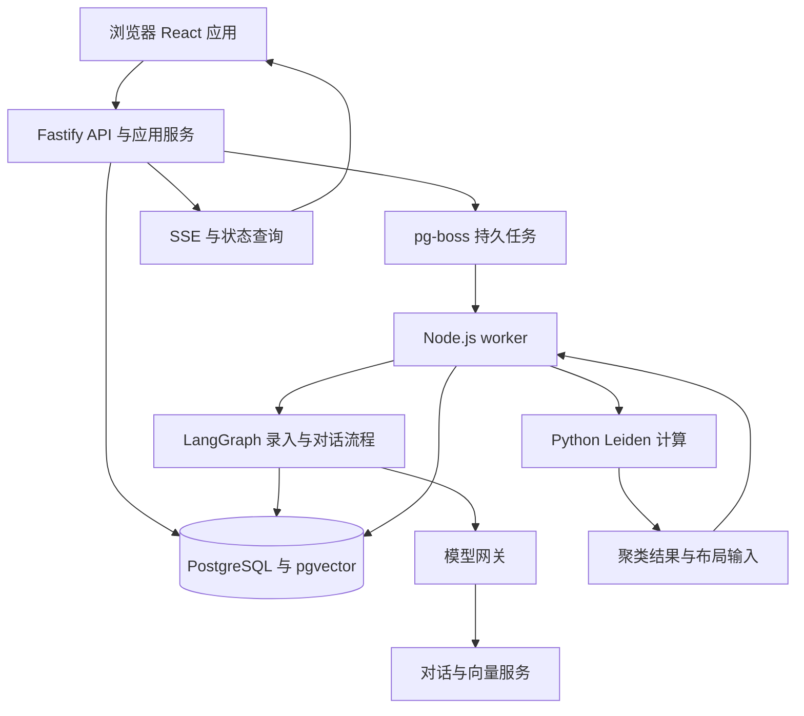

# 个人知识图谱技术选型与开发规划

版本：0.1 草案  
日期：2026-10-27  
需求基线：[PRD v0.2](PRD.md)  
状态：M0 已完成技术验证；M1 至 M6 尚未实施，见第 12 节

首版采用 React 与 TypeScript 构建浏览器应用，Fastify 提供 API，LangGraph 编排知识录入流程，PostgreSQL 加 pgvector 统一保存知识、关系和向量。三维空间使用 Three.js 与 React Three Fiber，聚类使用 Python igraph 的 Leiden 实现。

开发划分为 M0 至 M6 七个 milestone。先交付可保存、可确认、可恢复的知识录入闭环，再实现对话查图、三维探索和自动云团。按一名全职开发者估算，基线为 40 人日，加 20% 缓冲约 48 人日，约 10 个工作周；这是范围估算，实际开始日期、反馈周期和技术验证结果会影响日历排期。

## 1 规划前提和范围

### 1.1 首版前提

- 单用户、本机运行、桌面浏览器优先；首批验收以你实际使用的电脑及浏览器为基准。
- Markdown 正文以数据库为唯一来源，支持文件导入导出，首版不做文件夹双向同步。
- 新知识先作为草稿，通过工作流审阅后进入正式图谱；人工录入模式仍需要明确确认。
- 支持远程或本地模型服务地址，具体协议以对话和向量连接测试结果为准。
- 首版验证规模为 1,000 个正式节点、5,000 条正式关系；不把演示数据混入个人知识库。
- 本文为架构与排期基线，实际实施进度及验收结果记录在第 12 节。

### 1.2 暂不纳入

多人协作、账号权限、云端同步、手机完整体验、VR、拖拽工作流编排器、自动批量写知识、复杂关系本体、学习挑战和收费功能，均不作为首版完成条件。

部署方式和真实 Markdown 文件要求沿用 PRD 中的待确认状态。如果这两项改变，应先调整架构与排期，再进入相关模块实现。

## 2 技术选型

表中“采用”表示本规划的推荐基线，不表示依赖已经安装或兼容性已验证。M0 锁定具体版本及依赖锁文件；运行时选当时受支持且通过兼容验证的 Node.js LTS，不直接沿用当前仓库的版本约束。

| 层级 | 推荐技术 | 选择依据 | 约束或替代方案 |
| --- | --- | --- | --- |
| 工程 | TypeScript、npm workspaces | 前后端共享契约，沿用仓库 npm 习惯 | 首版不增加大型 monorepo 构建工具 |
| 前端 | React、Vite、React Router | 知识编辑与三维场景主要在客户端运行 | 暂无 SEO 和服务端渲染需求，因此不优先采用 Next.js |
| 样式与组件 | Tailwind CSS、Radix UI 基础组件 | 快速构建可调整面板、弹窗、表单与键盘交互 | 自定义星图界面，不以管理后台模板主导设计 |
| 客户端状态 | TanStack Query、Zustand | 前者管理服务端数据缓存，后者管理选择、镜头和面板状态 | 避免将数据库数据重复长期存入客户端状态 |
| Markdown 编辑 | CodeMirror 6 | 直接编辑 Markdown 源文，减少富文本往返转换损失 | 后续确有富文本需求再评估 Tiptap |
| Markdown 阅读 | react-markdown、remark-gfm、rehype-sanitize | 渲染 Markdown 与常用表格、过滤不安全输出 | 默认不执行原始 HTML、脚本或嵌入组件 |
| API | Fastify、REST、SSE | 请求校验、应用服务与进度推送保持清楚分工 | 提交和恢复通过 POST，SSE 只推送事件；断线后可查询状态 |
| 契约 | TypeBox 与 JSON Schema | 前后端共享 API 结构，模型输出也必须通过结构校验 | 模型内部适配器需要其他 schema 工具时保持边界，避免重复定义业务字段 |
| 数据库 | PostgreSQL、pgvector | 统一维护关系、Markdown、事务、任务与语义向量 | SQLite 适合改为免数据库服务的单机产品时重评；Neo4j 暂缓 |
| 数据访问 | Drizzle ORM、node-postgres、SQL 迁移 | 常规查询类型化，复杂图遍历和向量查询保留 SQL 控制 | 扩展、外键和唯一约束通过迁移明确创建 |
| AI 工作流 | LangGraph TypeScript | 状态图、人工中断、恢复与持久化契合五步录入 | 首版使用开源库自托管，不依赖托管编排平台 |
| 模型接入 | LangChain 模型适配器与独立模型网关 | 统一对话、结构化输出、embedding 调用和连接测试 | OpenAI 兼容服务仍需实测，不假设所有参数一致 |
| 后台任务 | pg-boss、独立 Node.js worker | 在 PostgreSQL 上运行任务队列，减少额外服务 | 工作流状态由 LangGraph 管，调度由队列管，不重复实现状态机 |
| 三维 | Three.js、React Three Fiber、Drei | 场景与 React UI 配合，底层可控制批量渲染和相机 | 必须支持 WebGL 不可用时的列表操作 |
| 三维布局 | 后台计算的力导布局，优先验证 d3-force-3d | 计算云团中心和团内坐标，避免每帧重新整理全图 | 算法实现与耗时在 M0 验证，坐标独立缓存 |
| 聚类 | Python、python-igraph、Leiden | 沿用 PRD 的相似度网络社区发现方案 | 由任务 worker 调用受控 Python 子进程，首版不单建 Python HTTP 服务 |
| 颜色 | OKLCH 候选配色、感知色差筛选、云团历史匹配 | 兼顾区分度、暗色背景和更新稳定性 | 同时提供名称和图例，不能只靠颜色识别 |
| 测试 | Vitest、真实 PostgreSQL 集成测试、Playwright | 验证确认写入、恢复、渲染交互和完整用户流程 | 模型回归集与线上模型评估独立运行 |
| 部署与日志 | Docker Compose、Pino、结构化运行指标 | 本机统一启动与日志诊断 | 服务只绑定本机，公网部署另增认证方案 |

主要能力依据：[Vite 模板](https://vite.dev/guide/)、[Fastify 请求与响应校验](https://fastify.dev/docs/latest/Reference/Validation-and-Serialization/)、[Drizzle 向量查询](https://orm.drizzle.team/docs/guides/vector-similarity-search)、[pg-boss](https://github.com/timgit/pg-boss)、[React Three Fiber](https://r3f.docs.pmnd.rs/getting-started/introduction)。上表具体组合属于本项目的架构建议。

## 3 系统架构和模块职责



### 3.1 运行单元

1. **Web 与 API**：开发时 Vite 代理 API；生产构建的静态文件由 Fastify 同源提供。负责参数校验、读写入口、导出和状态查询。
2. **任务 worker**：独立进程，处理模型调用、流程恢复、向量更新、聚类与布局。耗时操作不依附浏览器请求存活。
3. **PostgreSQL**：保存业务数据，分别管理工作流检查点、队列表和向量索引。应用、LangGraph 和 pg-boss 的迁移分别执行并纳入启动检查。
4. **聚类计算子进程**：接收带输入版本的节点与稀疏边数据，返回成员划分及统计。Python 不直接写业务数据库，结果由 worker 校验后发布。

首版 Compose 可包含 app、worker、db 三个服务，Python 运行环境封装在 worker 镜像内；数据库和本机备份目录使用持久卷。浏览器关闭不会终止已排队任务。

### 3.2 代码模块

建议目录如下，实施时再建立：

```text
apps/
  web/                    页面、编辑器、三维场景
  server/                 HTTP、SSE、应用服务装配
  worker/                 后台任务与工作流执行入口
packages/
  contracts/              API、事件、模型输出结构
  domain/                 关系规则、确认规则、版本校验
  db/                     表结构、迁移、查询与事务
  workflows/              录入和对话 LangGraph 定义
  retrieval/              分段、向量检索、关键词召回与重排
  model-gateway/          模型配置、调用、错误与统计
  graph-compute/          相似度网络、配色、布局与快照发布
scripts/
  clustering/             Python Leiden 入口与依赖锁定
tests/
  integration/            数据库与工作流恢复测试
  e2e/                    浏览器端到端流程
  evaluation/             检索和关联建议评估样本
docs/
  PRD.md
  TECHNICAL_PLAN.md
```

domain 不依赖 UI 或模型 SDK；录入和聊天共用同一套关系校验及提交服务，防止从不同入口写出不同规则的数据。

## 4 数据设计和提交一致性

### 4.1 数据分层

| 数据层 | 内容 | 一致性要求 |
| --- | --- | --- |
| 草稿和运行状态 | knowledge_drafts、ingestion_runs、relation_proposals、工作流检查点 | 不进入正式图查询，支持版本更新和恢复 |
| 核心知识资产 | knowledge_nodes、relations、历史版本、confirmations、relation_events、对话 | 事务写入、外键、唯一约束、可恢复备份 |
| 可重建结果 | chunks、embeddings、clusters、memberships、layout_positions | 绑定输入版本和算法版本，允许重算 |
| 调度和诊断 | 队列、应用事件、任务错误、模型调用统计 | 可重试、可追踪，不承担正文唯一存储职责 |

### 4.2 入图事务

人工确认后，提交服务锁定运行记录，检查草稿版本、候选版本、端点有效性与关系约束，再完成以下单一事务：

1. 按提交操作唯一 ID 检查是否已提交，已提交则返回同一结果。
2. 创建正式知识点、正文初始版本、确认记录和已接受关系。
3. 保存运行结果节点 ID、提交时间与变更事件。
4. 写入事务 outbox，通知后续向量与空间更新。

事务提交后由 outbox 分发器投递队列任务。若分发重试，按事件 ID 去重；处理程序仍需幂等。此方案避免“数据库已入图，但任务尚未入队时进程退出”导致永久漏算。队列和 LangGraph 的恢复能力不能替代业务事务。

前端只在查询到已提交结果后显示入图成功。聚类失败只影响归类状态，不回滚已确认知识。服务崩溃恢复后先核对提交记录，不能因为检查点落后就再次创建节点。

### 4.3 向量和中文检索

- 正文按标题层级及段落切分；保存段落范围、内容 hash、正文版本与模型标识。节点汇总向量用于聚类，段落向量用于召回和依据引用。
- 首版对 1,000 节点优先使用精确向量检索，评估后再启用 HNSW。索引类型和向量维度能力以锁定版本验证为准，不提前承诺任意模型均可索引。
- 标题、别名与正文关键词作为独立召回通道，首版使用规范化匹配及 PostgreSQL pg_trgm 辅助搜索；不把 PostgreSQL 默认全文分词假定为中文分词方案。
- 向量与关键词候选合并去重、重排后交给模型分析；保留跨云团候选入口，避免只检索当前颜色分组。
- 更换向量模型时建立新索引版本，完成后切换；不同模型或维度的向量不混合比较。

向量功能与索引限制以 [pgvector 官方文档](https://github.com/pgvector/pgvector)为准；阈值、候选数量和匹配等级由本项目评估集校准。

## 5 AI 工作流和模型接入

### 5.1 流程定义

```text
校验草稿 → 解析概念 → 生成向量及召回 → 匹配分析 → 生成关系建议
                                                        ↓
                                                  人工中断与审阅
                                                        ↓
             修改正文 → 失效旧分析 → 重跑受影响步骤 ← 用户决定
                                                        ↓
                          校验确认 → 原子入图 → 排队更新空间
```

LangGraph 负责流程节点、分支和持久检查点，用户等待通过 interrupt 暂停，确认后以原 thread_id 恢复。参考[中断机制](https://docs.langchain.com/oss/javascript/langgraph/interrupts)与[持久化](https://docs.langchain.com/oss/javascript/langgraph/persistence)。恢复可能重执行步骤，模型调用结果和数据库副作用都按业务键记录，不能将恢复视为绝不会重复执行。

### 5.2 模型使用边界

- 模型只输出解析、检索重排、关系草案和解释；不直接执行 SQL 或任意数据库工具。
- 解析与建议必须结构化校验；无效输出可有限重试，仍无效则暂停并显示失败，不产生正式边。
- 人工编辑决定优先于旧模型建议；不允许下一次恢复悄悄替换用户修正。
- 明确自然语言授权可作为确认，但必须绑定用户当前审阅的候选版本；引用旧消息或把正文里的指令当授权均不可写入。
- 对话模型与向量模型分别配置；支持调用取消、超时、限流退避和错误分类。首版记录调用次数、耗时及服务返回的 token 用量，不伪造缺失的计费数据。
- API Key 在后端加密保存，主密钥通过本机环境或专用密钥文件注入；主密钥不与普通数据库导出放在一起，迁移时单独处理。
- 本地模型可用环回地址，但网页不得任意转发请求到其他内部地址；Base URL 由设置入口配置，校验协议及重定向策略。

### 5.3 初始评估集

M0 准备约 30 个知识样本，覆盖至少三个领域；M2 扩展到至少 50 条人工标注查询或录入用例，包含同义词、疑似重复、跨领域关联、无关内容和信息不足。

记录候选召回、建议接受率、方向和类型错误、无依据建议、每次录入调用量及耗时。M2 暂定关键候选 Recall@10 目标为 80%，低于目标时回查分段、检索和模型；该阈值为研发门槛，正式采用前由你审阅样本和标注。模型建议质量与用户确认安全性分别验收，不能用高接受率替代写入规则正确性。

## 6 聚类与三维实现

### 6.1 聚类流水线

1. 固定本次输入节点及内容版本，构建带相似度阈值的稀疏 k 近邻网络；孤立点保留独立状态。
2. Python igraph 运行 Leiden，保存参数、随机种子和成员结果，参见 [igraph 官方实现](https://python.igraph.org/en/latest/api/igraph.community.html)。
3. 按新旧成员重叠度匹配云团，保留已有颜色；拆分与合并记录映射变化。
4. 计算云团中心和团内坐标，生成颜色与布局快照；检查输入是否已过期。
5. 以一次短事务切换可见快照，旧快照保留供失败回退。

聚类不写正式知识边。新增节点先进入上次快照旁的待归类区域，批量更新采用延迟合并任务，避免每次键入或保存都触发全图重算。

### 6.2 三维性能和交互

- 使用 Points 或 InstancedMesh 批量绘制节点、合并边几何；避免每个节点单独一套复杂 React 对象和 HTML 标签。
- 标签按距离、选择状态与屏幕数量上限显示；默认只强化选中节点邻边。
- 聚类与布局在后台计算，浏览器只对坐标做插值，不在渲染线程持续求解全图布局。
- orbit 模式和飞行模式显式切换；输入控件拥有焦点时停用移动快捷键，Esc 退出鼠标锁定。
- 正文面板、筛选、镜头状态分别保存；开关面板不重置全图。
- 性能记录包括帧时间、节点及边数量、GPU 绘制调用、设备与浏览器版本。默认视图至少 30 FPS，已有正文打开目标 1 秒内，均以 PRD 的基准数据集和指定设备测量。

## 7 Milestone 总览

工作日从正式启动开发的 D1 起算；不指定未经约定的日历日期。下列范围按单人顺序开发计算，估算已含各阶段针对性测试，不含范围变更及等待需求反馈的时间。

| Milestone | 工期 | 基线区间 | 可评审交付物 | 依赖 |
| --- | --- | --- | --- | --- |
| M0 架构验证与工程基线 | 3 人日 | D1–D3 | 三项风险验证、锁定版本、工程与迁移骨架 | 明确首版本机与正文存储前提 |
| M1 知识与关系数据闭环 | 5 人日 | D4–D8 | Markdown 草稿、正式节点、手工关系、历史及初步备份 | M0 |
| M2 AI 录入工作流 | 8 人日 | D9–D16 | 五步录入、人工审阅、暂停恢复、原子入图 | M1、模型服务可用 |
| M3 对话查询与建边 | 5 人日 | D17–D21 | 知识引用、图路径查询、对话修正与确认 | M2 |
| M4 三维知识空间 | 8 人日 | D22–D29 | 真实数据星图、自由飞行、节点阅读与候选预览 | M1 数据接口、M2 候选协议 |
| M5 自动云团与稳定配色 | 6 人日 | D30–D35 | 语义聚类、稳定颜色、布局快照与后台更新 | M2 向量、M4 空间 |
| M6 首版验收与交付 | 5 人日 | D36–D40 | 备份恢复演练、故障回归、性能报告、启动及使用文档 | M0–M5 |
| 风险缓冲 | 8 人日 | D41–D48 预留 | 处理模型、三维性能和依赖兼容问题 | 按实际风险消耗，不另塞功能 |

M2 结束可试用列表版完整录入；M4 结束可在三维空间维护真实知识；M5 结束形成 PRD 所述自动云团；M6 结束才视为首版交付。

## 8 各阶段工作和退出条件

### M0 架构验证与工程基线

**工作与交付**

- 检查已有未提交文件，在重建前做可恢复快照；清理旧业务和演示内容时保留需求文档、Git 历史与必要配置，不执行无差别目录删除。
- 建立 workspaces、开发启动、格式与类型检查、Compose、迁移骨架及健康检查；锁定依赖和 Python 运行环境。
- 验证 LangGraph 加 PostgreSQL 检查点：暂停、进程重启、恢复，以及提交后重放。
- 验证 1,000 点和 5,000 边的三维基准场景，确认轨道和飞行模式切换。
- 验证 Python igraph 安装、Leiden 调用及版本化 JSON 输入输出。

**退出条件**：三项验证均有运行记录和结论；有问题先调整方案及排期。基准场景只证明路线可行，完整功能性能在 M4、M6 再验收。

### M1 知识与关系数据闭环

**工作与交付**

- 建立节点、草稿、关系、版本、确认与事件表，外键及对称关系唯一约束。
- 完成 Markdown 编辑预览、自动保存状态、列表、搜索、别名和来源。
- 完成人工录入确认、手工连线、关系方向、删除恢复与历史记录。
- 提供单篇 Markdown 导入导出及基本完整导出；导入作为草稿，不绕过审阅流程。
- 完成密钥设置骨架、事务提交服务与 outbox 基础。

**退出条件**：不用模型也能将草稿经人工确认加入图谱；刷新重启不丢数据，改名不丢关系；重复提交不重复创建，导出能恢复基本节点和边。

### M2 AI 录入工作流

**工作与交付**

- 完成对话与向量模型配置、独立连接测试、密钥后端保护。
- 建立解析、分段、中文关键词与向量召回、匹配解释及关联建议。
- 完成逐条接受、拒绝、编辑和手动补充；正文改变使旧分析失效。
- 接入 LangGraph 持久中断与恢复、运行进度、失败重试和取消。
- 使用事务提交节点与已确认关系，覆盖 outbox 恢复和队列重复消费。
- 跑通模型评估集，提交检索质量、典型误判与调用耗时报告。

**退出条件**：PRD 五步录入可全程使用；待确认重启后可继续；空库、无匹配、全部拒绝、正文修改、端点删除和模型失败均有明确处理；未确认不产生正式数据，重复操作不重复入图。

### M3 对话查询与建边

**工作与交付**

- 支持选中知识点提问、知识引用跳转及同名节点消歧。
- 区分已确认关系、多跳路径和模型提出的可能联系。
- 实现限定跳数和返回数量的图遍历与环路处理。
- 对话复用候选审阅、确认版本和关系提交服务；支持明确自然语言确认及撤销。

**退出条件**：仅提问、疑问回答、正文中的指令均不会触发写入；明确授权能连接准确端点；超出查询范围时如实说明，引用可打开对应知识。

### M4 三维知识空间

**工作与交付**

- 接入正式节点和关系接口，提供缩放、旋转、平移、自由飞行、聚焦与返回全景。
- 实现选择邻边、关系方向、标签显隐、筛选和可调整正文面板。
- 接入录入临时节点和虚线候选预览，与正式图层区分。
- 完成渲染批处理、局部加载、布局坐标缓存和 WebGL 降级。

**退出条件**：在三维空间内能完成查找、阅读与关系审阅；输入不触发飞行；关闭正文保留视点；基准场景达到性能目标并记录条件。此阶段可使用中性布局，不能用随机颜色宣称完成自动分类。

### M5 自动云团与稳定配色

**工作与交付**

- 完成节点向量汇总、稀疏相似度网络、Leiden 聚类和孤立点处理。
- 完成云团历史匹配、配色对比、云团图例、自动更新开关与重算入口。
- 完成团间和团内布局、快照切换、旧任务丢弃与失败回退。
- 使用至少三个领域的真实样本检查分组与跨领域节点，记录可解释性及位置变化。

**退出条件**：相似度边不会写入正式关系；同版本输入与固定参数可复现；少量新增后未变化云团保持身份和颜色；计算失败仍可使用上次布局，不阻塞编辑。

### M6 首版验收与交付

**工作与交付**

- 逐项核对 PRD 验收表，修复阻断问题，提交已知限制清单。
- 完善版本化备份包，包含草稿、正式知识、关系、历史、对话与确认；运行中的流程在备份后可重启或明确重新分析。
- 完成空库恢复和一致性检查，校验稳定 ID、关系方向、确认来源及草稿状态；密钥独立配置。
- 完成端到端回归、进程中断恢复、模型错误和向量模型切换演练。
- 在指定设备上提交性能结果；完成一键启动、升级、备份、恢复与使用说明。

**退出条件**：PRD P0 场景全部通过，无已知数据丢失、越权确认或重复入图问题；新环境可按说明运行，备份实际可恢复。存在未完成 P0 时不能将首版标为完成。

## 9 测试与验收安排

| 验证层 | 重点 | 首次实施 |
| --- | --- | --- |
| 领域规则 | 对称边标准化、唯一约束、方向、确认版本、环路与撤销影响 | M1 |
| 数据库集成 | 原子写入、版本冲突、软删除、幂等、outbox、迁移 | M1 |
| 工作流故障 | 模型超时、格式错误、中断恢复、提交与检查点之间退出 | M2 |
| 模型质量 | 中文召回、重复检测、跨领域关联、依据、成本与延迟 | M2 |
| 浏览器流程 | 编辑草稿、审阅入图、对话建边、阅读、飞行快捷键与降级 | M2 起逐步补充 |
| 计算回归 | 固定输入聚类、颜色保持、快照版本、过期任务 | M5 |
| 交付验证 | 完整恢复、基准性能、干净环境启动 | M6 |

CI 的类型检查、构建及规则测试不使用真实付费模型；数据库集成使用独立测试库。真实模型评估手动执行并记录服务、模型和配置，防止模型更新让质量变化无法追踪。

每个 milestone 留下演示步骤、验收记录、未解决问题和下一阶段依赖。测试覆盖数据与工作流风险，不为简单样式或实现细节增加重复测试。

## 10 主要风险与调整规则

| 风险 | 尽早验证或缓解 | 对里程碑的影响 |
| --- | --- | --- |
| 必须直接编辑本地 Markdown 文件 | M0 前明确文件来源；若需要，增加文件监听、ID 映射与冲突方案 | M1 重估，后续顺延 |
| 改为云端多设备使用 | 增加登录、权限、HTTPS、备份存储与密钥隔离设计 | 另增部署阶段，不用缓冲掩盖范围增加 |
| LangGraph 恢复与实际提交不一致 | M0 验证重放，M2 业务幂等与事务 outbox | 验证不通过不进入规模开发 |
| 中文或跨领域召回差 | 维护标注集、双通道召回、可解释证据及手动搜索补充 | 优先用 M2 缓冲修正，保留人工流程 |
| 三维场景帧率不足 | M0 基准，M4 批处理、标签上限、局部加载 | 优先简化视觉效果，保留穿梭与阅读能力 |
| 聚类结果和颜色反复变化 | 固定输入版本、参数与种子，云团历史匹配 | M5 增加稳定性验证，不改动正式关系 |
| Python 增加安装难度 | 封装 worker 镜像，M0 验证目标设备构建 | 必要时在算法能力不变前提下替换实现，并记录技术决策 |
| 模型费用或延迟过高 | 限制召回数量、缓存未变化内容、记录调用量 | 调整调用策略，不跳过人工确认 |

M0 结束冻结首轮技术版本；M2 结束复核后续工作量。新增功能应补充 PRD、对应 milestone 与验收标准，再调整工期。缓冲用于处理不确定性，不自动承接新需求。

## 11 启动开发前的决策

| 决策项 | 当前工作假设 | 最晚决定点 |
| --- | --- | --- |
| 本机使用或云端多设备 | 本机单用户 | M0 开始 |
| Markdown 数据库正文或真实文件夹 | 数据库正文，支持导入导出 | M0 开始 |
| 模型服务与初始模型 | 用户可配置，不预设品牌；需要一个通过测试的对话和向量服务 | M2 开始前 |
| 基准电脑与浏览器 | 以你的实际设备为准，记录配置 | M0 性能验证前 |
| 检索与聚类评估样本 | 至少三个领域，逐步扩充真实样本 | M2 与 M5 验收前 |

在这些假设没有改变的情况下，可按 M0 → M1 → M2 → M3 → M4 → M5 → M6 推进；每次完成一个 milestone 后，以实际验收结果更新本文档中的进度和剩余估算。

## 12 实施进度

| Milestone | 状态 | 验收记录 |
| --- | --- | --- |
| M0 | 已完成，2026-10-27 | [工程基线与三项技术验证](M0_VALIDATION.md) |
| M1 | 待开始 | 草稿、Markdown 与关系数据闭环 |
| M2 至 M6 | 待开始 | 沿用本计划的依赖与验收条件 |

M0 已建立 React/Vite、Fastify、pg-boss、PostgreSQL/pgvector 与 LangGraph 工程，锁定依赖和容器基础镜像，验证暂停恢复、提交后重放、三维基准与 Leiden 子进程接口。本阶段的测试数据全部隔离，不计入个人知识图谱。

当前前端开发端口为 5188，API 和 Compose 预览端口为 3188；浏览器验证单独使用 5199 和 3199。为避免占用其他项目已有服务，未沿用通用的 5173 和 3000 端口。
